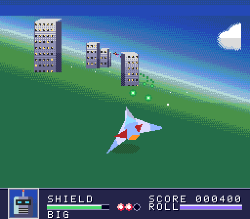

# Comet Lancer

An on-rails 3D shooter for the TurboGrafx-16 / PC Engine model in
`tg16-core`, in the style of the early-90s polygon flying games (Star Fox
on the SNES). The name, ship, enemies, co-pilot and art are original and
are all drawn by code; there are no image assets.

Fly over a green planet, go through gold rings to get shield back, dodge
the towers and shoot down Hornet fighters before they shoot you. ROVY, the
robot co-pilot in the info bar, calls out what is coming.



## Playing

```sh
ppu tg16 check crates/tg16-core/toys/comet_lancer --duration 20
ppu tg16 render crates/tg16-core/toys/comet_lancer --at 2,6,10 -o previews
ppu tg16 pack crates/tg16-core/toys/comet_lancer
```

In the browser viewer it is listed as `comet_lancer`.

| Pad | Viewer key | Does |
| --- | --- | --- |
| d-pad | arrows | steer; up climbs |
| I | X | twin lasers (hold for auto fire) |
| II | Z | barrel roll: enemy shots miss while you roll; uses half the ROLL meter |
| Select | Shift | nova bomb: destroys every Hornet and shot in view (3 per game) |
| Run | Enter | start a game; after a game over any button plays again |

With nobody at the pad the ship flies itself (an attract mode), so
`render`, `check` and the ROM export show a game being played.

## Files

| File | What is in it |
| --- | --- |
| `10_raster.lua` | the software 3D renderer (transform, light, cull, sort, fill) and the scaled sprite sets |
| `20_models.lua` | the ship and Hornet models, sprite palettes, and the pre-scaled art |
| `30_world.lua` | the background: tilting sky and ground gradients, the info bar, the font and the co-pilot portrait |
| `main.lua` | the game: course, ship, camera, collisions, autopilot, messages, drawing, sound |

## How it works

The SNES got polygon games from a Super FX chip in the cartridge. The TG16
has nothing like it: one background layer, 64 sprites, no scaling, no
rotation, no transparency. Each trick below is something a HuCard game
could do.

### The player's ship: real polygons, filled by the CPU

The Lancer is 26 vertices and 17 faces. Every frame `R3.draw` in
`10_raster.lua`:

1. rotates the vertices by the ship's roll, pitch and yaw, plus a fixed
   look-down angle, and projects them with a small perspective divide;
2. lights each face from one direction and picks one of four shades of its
   material (hull, trim, fins), culls faces turned away, and sorts the rest
   far to near (the painter's algorithm);
3. fills each face as horizontal spans into a 64x64 pixel buffer.

The buffer goes to VRAM as two 32x64 sprites. Only the 16x16 cells that
have pixels this frame, or had them last frame, are uploaded: about 500
VRAM words for a level ship and 800 in a barrel roll, within the ~1400
that fit in vertical blank.

The core cannot see Lua doing math, so the toy charges the fill to the
budget meter itself with `cpu(cycles)`: about 150 cycles per vertex, 260
per face, 40 per span and 6 per pixel, plus clearing used cells. That is
20,000 to 30,000 cycles, a sixth to a quarter of a frame.

### Everything else in 3D: pre-scaled sprite sets

Hornets, towers, rings, bolts, explosions, ground specks, clouds and the
ship's shadow are drawn once in `init()` at 2 to 10 sizes each and stored
as sprite patterns. The Hornet sizes are rendered by the same polygon code
(a level and a banked pose, the banked one mirrored for the other
direction). Each frame an object's position goes through a perspective
divide, is turned around the screen centre by the horizon's tilt, and the
set supplies the size nearest its on-screen size.

VRAM tricks a real game would use:

- **Rings** store only the top-left quarter; the other three are the same
  patterns drawn with the sprite flip bits.
- **Towers** store one side view and flip it so the side facing the camera
  shows. Their faces and the shadow are dithered, the way the SNES game
  shades its polygons.
- Large objects are several 32x64 sprites side by side.

Sprites are sorted nearest first, so near things cover far things. A line
holds 16 sprite units on a TG16; when a sprite would go over that on any of
its lines, the toy leaves the farthest ones out instead of letting the
hardware drop whichever sprites come last.

### Sky and ground: a tilting horizon on one background layer

The TG16 cannot rotate a layer, but on every line it can pick which map
row to show (a `BYR` reload) and scroll that row sideways. A tilted horizon
crosses each line at one point, so each line needs a row that is sky on one
side of a point and ground on the other, scrolled so that point lands where
the horizon crosses that line. Done on every line, that draws a straight,
tilted horizon with every pixel of the edge in the right place.

The map (128 x 64 tiles) holds:

- **Ramp rows**, two per stored tilt (one with the ground on the right, one
  mirrored), for 11 tilts from 1 to 22 degrees. Along a ramp row the colour
  follows the distance from the edge, measured square to the horizon at
  that tilt, so the gradient tilts with the horizon. The ground gets 704
  pixels of the row and the sky 320.
- **Flat rows**, 20 for the ground and 18 for the sky, one colour each,
  for flying level and for lines far from the horizon.
- The info bar's 4 rows.

The gradients are 15-colour palettes (one for the ground, one for the sky)
drawn with a 2x2 ordered dither between neighbouring colours, in tiles
that every row shares (about 60 of them). Each line starts on a map pixel
row of its own parity, so the dither stays a fine checkerboard on screen.

For each of the 192 lines of the view, a raster hook works out where the
horizon crosses it and picks:

1. a ramp row with its edge placed exactly, when the horizon crosses the
   line or is just off the screen;
2. a ramp row scrolled so the colour at the centre is right, a bit farther
   away (the row's stretch is the nearest stored tilt, so matching the
   centre beats matching an edge nobody can see);
3. a flat row of the centre's colour, farther still.

White specks on the ground (sprites) show the speed now that the ground is
a smooth gradient, and the horizon follows half the ship's bank. Lines
192 to 223 reload to the info bar's rows and hide sprites.

### The info bar

Background tiles, like the rest: a 32x32 portrait of ROVY with a two-frame
mouth that moves while a message is typed out a letter per two frames, the
shield bar (green, then yellow, then red, by one palette write), the score,
a ROLL meter that refills, and three nova bomb icons. Only map cells that
change are rewritten, a few VRAM words a frame.

### What it costs

From `ppu tg16 check --duration 40`:

| Meter | Peak | Limit |
| --- | --- | --- |
| CPU (estimate) | about 55% of a frame | 100% |
| Software cycles (`cpu()`) | about 32,000 | 119,318 per frame |
| Raster lines | 224 (every line) | 224 |
| Sprites | 33 | 64 |
| Busiest line | 16 units | 16 |
| VRAM words per frame | about 790 | about 1400 in vertical blank |

It runs at 60 frames a second with room to spare. `ppu tg16 rom` turns 20
seconds of the attract mode into a 1 MB HuCard image that plays in
Mednafen, tilting horizon included; that ROM is a recording, not the game,
because Lua does not run on the console.

## Where the TG16 does better than the SNES here

- **CPU speed.** The HuC6280 runs at 7.16 MHz; the SNES's 65816 runs at
  2.68 to 3.58 MHz and spends more cycles per instruction on many
  operations. That is why a CPU-filled polygon ship at 60 fps, and a raster
  hook on every line, are believable on a TG16 with no extra chip. An SNES
  without a Super FX would struggle to do the same.
- **Frame rate.** Star Fox drew its whole world in polygons and ran at
  roughly 15 to 20 frames a second. Comet Lancer draws far less in 3D, but
  everything moves at a smooth 60.
- **Big sprites and many sprite palettes.** TG16 sprites can be 32x64 and
  there are 16 sprite palettes of 15 colours, so large multi-colour objects
  (the close-up rings and towers, the 64x64 ship) are cheap to build. The
  SNES has 8 sprite palettes and two sprite sizes per screen.
- **Colours on screen.** 16 background and 16 sprite palettes give up to 482
  colours at once, against the SNES's 256-entry CGRAM. The sky and ground
  ramps, the info bar, the portrait and every object type get palettes of
  their own.
- **A big map.** A 128x64-tile map leaves room for 22 pre-stretched ramp
  rows, 38 flat rows and the info bar side by side.

## Where it falls short

- **No polygon hardware.** Only the player's ship is truly 3D. The Hornets
  are pre-rendered: they bank between two fixed poses and never turn to show
  a new side. A Super FX game draws every object, and the ground features,
  as live polygons that can be seen from any angle.
- **The world turns, the objects do not.** The horizon tilts and objects
  move to their turned positions, but sprites cannot rotate: towers stay
  upright on a tilted ground, and rings stay round side up.
- **The ground cannot carry a texture.** A textured floor (the first
  version's checkerboard) can scroll and scale by line, but cannot tilt. So
  the ground is a smooth gradient with sprite specks for speed, and the
  course is a straight line.
- **Gradients are stored at 11 tilts.** Between them the stretch is a
  little off. At shallow banks (1 to 3 degrees) the ramp rows cover only a
  short distance from the horizon, so a faint seam can show where lines
  change from ramp rows to flat rows. The edge of the horizon is always
  exact.
- **One background layer.** Sky, ground and info bar all share it, and the
  view needs a raster hook on every line. The SNES has two to four layers
  and Mode 7 for the same job, with HDMA doing the per-line work.
- **No colour math.** There is no transparency: shadows and tower shading
  are dithered, there are no translucent explosions, and the nova bomb's
  flash rewrites 30 palette entries instead of adding to the colours.
- **Fewer sprites per line.** 16 units per line (and 64 sprites in all)
  against the SNES's 32 sprites and 128 in all. Wide close-up objects use up
  a line quickly, which is why the toy drops far sprites on busy lines.
- **Only 512 colours to pick from.** Each channel has 8 levels, so the
  gradients rely on dithering where the SNES's 32 levels per channel would
  look smooth.
- **Mid-line palette writes are late.** On real hardware a palette write
  from a raster interrupt lands a few pixels into its line. The toy now
  avoids per-line palette writes (the gradients are tiles), but the SNES
  changes colours with HDMA during horizontal blank with no such worry.

## A Lua gotcha found here

piccolo (the Lua VM) does not always clear parameters a caller leaves out:
`say("hi")` can find a stale value from the calling function in its second
parameter instead of `nil`. So every call in this toy passes every
argument, even the optional ones (`say(msg, 120)`, `put_set(..., false)`).
